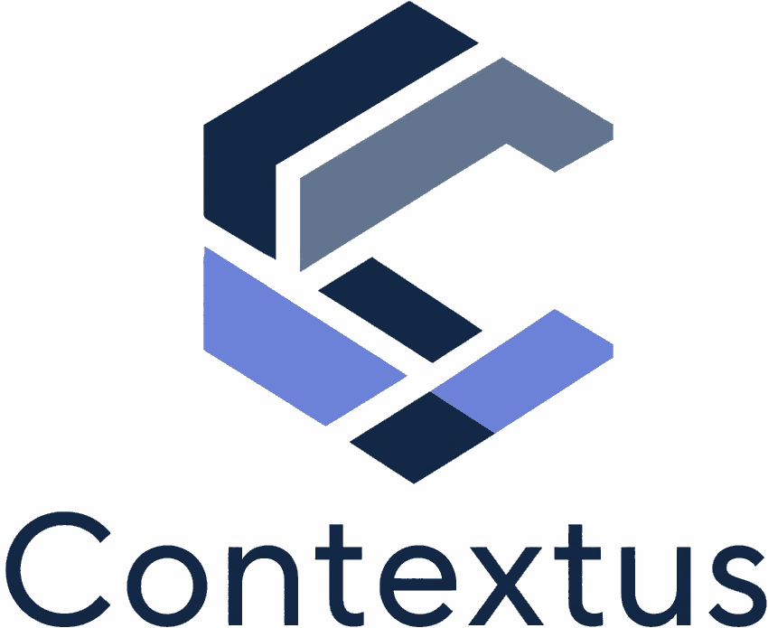

<p align="center">
  
</p>

<p align="center">
  <strong>Proactive context for Claude Code</strong><br>
  Stop searching for patterns — let them find you.
</p>

<p align="center">
  <a href="https://github.com/anthonypdawson/claude-contextus/releases">
    
  </a>
  <a href="https://github.com/anthonypdawson/claude-contextus/actions/workflows/test.yml">
    
  </a>
  <a href="https://github.com/anthonypdawson/claude-contextus/actions/workflows/release.yml">
    
  </a>
</p>

## Overview

**Problem**: Claude forgets your architecture decisions, coding patterns, and project conventions between sessions. You spend time re-explaining the same context, or worse — Claude gives advice that contradicts decisions you made last week.

**Solution**: claude-contextus automatically captures and surfaces project knowledge as you work. When you discover a pattern or make a decision, Contextus proposes capturing it. On future prompts, Claude sees that context automatically — no manual searching, no "remember to look this up."

**How it works**:
1. You work with Claude as normal
2. Contextus captures patterns you discover (decisions, gotchas, conventions)
3. Claude sees them automatically when relevant

The system stores everything as markdown files (git-trackable, human-readable, merge-friendly) — you *can* edit them directly, but most users let the capture flow handle it.

## Why Contextus?

**Captures knowledge as you discover it.**

Most RAG tools require you to write documentation upfront. Contextus learns from your work — when you debug an issue, make an architectural choice, or discover a gotcha, it offers to capture that knowledge. No separate "documentation time," no context-switching.

**Works without Ollama, works better with Ollama.**

Starts with keyword search (zero setup), upgrades to semantic embeddings when you add Ollama or Transformers.js. No infrastructure gate blocking day-one value.

**Proactive, not reactive.**

Injects relevant context automatically on every prompt. You capture patterns once, Claude sees them forever — no manual "check the docs" step.

**One file per pattern, all in git.**

Markdown files, human-readable, merge-friendly, version-controlled. No vendor lock-in, no binary formats. Your knowledge is YOUR data, editable in any text editor.

## Features

**See [docs/FEATURES.md](docs/FEATURES.md) for comprehensive coverage** — this is the highlight reel.

### 🎯 Proactive (Not Reactive)

- **Zero-query injection** — Context appears automatically on every prompt, no manual searching
- **Learns what's useful** — Tracks which patterns actually help vs. just retrieved
- **Automatic rebuilds** — Embeddings stay fresh as your knowledge grows
- **Pattern capture** — Proposes new patterns as you discover them

### 🧠 Smart Retrieval

- **Hybrid search** — Fuses semantic + keyword (RRF), nails exact symbols ("getLogger") that pure embeddings miss
- **Multi-vector expansion** — Generates alternate phrasings when search scores poorly, dramatically improves recall
- **Keyword fallback** — When provider is down, falls back to BM25 so you still get context
- **Multi-source** — Searches project + user patterns and docs simultaneously

### 📊 Observability & Tuning

- **Token cost reporting** — Shows overhead % paired with usage rate (`/context-status --cost`)
- **Calibration tools** — Tune injection floor from real usage data (`/context-calibrate`)
- **Live activity stream** — Watch retrievals in real time (`/contextus-watch`)
- **Self-documenting** — Introspect endpoint exposes config + corpus stats

### 🛠️ Integrated Workflow

- **26 skills** — Setup, create, audit, search, tag, calibrate, debug
- **Auto-hooks** — File changes trigger rebuilds, prompts inject context
- **JSONC config** — Hot-reload (no restart), comments allowed
- **Team-friendly** — Markdown files, git-trackable, merge-friendly

## Requirements

### Retrieval Modes

✓ **Keyword search only** (zero setup — works immediately)  
✓ **Local embeddings via Ollama** (recommended: `ollama pull nomic-embed-text`)  
✓ **Local embeddings via Transformers.js** (in-process, one-time model download)  
✓ **Automatic fallback** when embeddings unavailable

**Start with keyword search, add semantic search later if you want better recall.** The system works without Ollama — it just works *better* with it.

### Other Requirements

- **Claude Code** (CLI, desktop, or IDE extension)
- **Node 22+** — the daemon runs on it (`engine-strict` enforces this on install)
- **A C/C++ build toolchain** on the target machine — the native `@lancedb` bindings
  build during install (Xcode CLT on macOS; `build-essential` on Linux)

## Installation

> ⚠️ **Marketplace install untested on clean machines.** The flow below is wired but
> unverified end-to-end — use `--plugin-dir` for now until smoke-tested.

**[v1.1 — GitHub marketplace]** Add the marketplace, then install:

```text
/plugin marketplace add anthonypdawson/claude-contextus
/plugin install contextus@claude-contextus
```

Hooks activate automatically (no enable step), the daemon starts on your next session
(first launch installs native deps — one-time latency), and skills appear under the
`/context-*` / `/contextus-*` namespace.

**[v1 today — clone + `--plugin-dir`]** Until the marketplace listing is live:

```bash
git clone https://github.com/anthonypdawson/claude-contextus ~/src/claude-contextus
cd ~/src/claude-contextus && pnpm install   # builds the native deps; needs Node 22
# then, in any project you want contextus active:
claude --plugin-dir ~/src/claude-contextus
```

> **Note:** the `claude plugin install` command and an `enabledPlugins` settings block
> are NOT how this installs — use the marketplace flow above. See
> [docs/quick-start.md](docs/quick-start.md) for the full walkthrough.

## Quick Start

See **[docs/quick-start.md](docs/quick-start.md)** for the 5-minute version. The short
form:

### 1. Set up the project

```text
/contextus-setup
```

Scaffolds `.claude/context/`, registers a small marked stanza in your `CLAUDE.md`, and
builds the initial embedding corpus. Migrating from an older `.claude/memory/` system?
Run `/migrate-memory` (see [docs/MIGRATION_GUIDE.md](docs/MIGRATION_GUIDE.md)).

### 2. Create your first context pattern

```bash
/create-context "Always use TypeScript strict mode" "We've had issues with `any` types causing runtime errors"
```

### 3. Embeddings build automatically

On first use, embeddings are generated and stored in `~/.contextus/data/` — a single shared database with per-project scoping (per-user, not committed to git).

### 4. Automatic context injection

Ask a question, and relevant context patterns are injected automatically:

```
You: "How should I handle errors in TypeScript?"

Claude: [Sees relevant "TypeScript strict mode" context pattern injected]
"Based on our patterns, always use strict mode and avoid `any` types..."
```

## Skills

**Setup & capture**
- `/contextus-setup` — First-run setup for a project (scaffold + CLAUDE.md stanza + embed)
- `/create-context <topic> <content>` — Create a new context pattern with validation
- `/add-patterns <file> <patterns>` — Add patterns to an existing context file
- `/create-doc <topic> <content>` — Create a documentation file
- `/migrate-memory` — Convert a legacy `.claude/memory/` system into context files
- `/tag-context` — Backfill topical tags on untagged context files

**Health, tuning & troubleshooting**
- `/context-status` — Impact dashboard (corpus size, injection rate, latency)
- `/context-doctor` — Diagnose problems (no injections, wrong corpus, phantom re-embeds)
- `/context-calibrate` — Tune the per-project injection floor + usage-eval refinement
- `/context-search <query>` — Manual semantic search (debugging; shows scores + floor)
- `/rebuild-embeddings` — Regenerate all embeddings from scratch
- `/audit-context`, `/audit-stale` — Validate structure / flag stale patterns
- `/configure` — Adjust configuration

See **[docs/usage.md](docs/usage.md)** and **[docs/calibration.md](docs/calibration.md)**
for day-to-day workflows and tuning.

## Configuration

Config resolves through **3 tiers (later wins)**:

1. **`plugin.json`** `config` block — the shipped global default
2. **`~/.contextus/data/<project>/config.json`** — machine-local, per-project (where
   `/context-calibrate --floor --apply` writes)
3. **`<project>/.claude/contextus.json`** — git-committed, team-shared, **wins**

Only include the keys you're overriding. The shape (from `plugin.json`):

```json
{
  "config": {
    "enabled": true,
    "retrieval": {
      "topK": 5,
      "injectionFloor": 0.45,
      "maxTokens": 3000
    },
    "contextCapture": { "mode": "propose" },
    "embedding": {
      "provider": "ollama",
      "ollamaModel": "nomic-embed-text",
      "model": "nomic-ai/nomic-embed-text-v1.5"
    }
  }
}
```

> **`injectionFloor`, not a fixed threshold.** It's the gate ("inject anything at
> all?") and it's **per-project** — calibrate it to your corpus rather than trusting a
> universal default. See [docs/calibration.md](docs/calibration.md).

## How It Works

1. **Daemon**: Persistent HTTP server keeps embedding model warm (~100-200ms per query)
2. **Auto-injection**: Every prompt triggers semantic search → top-k patterns injected automatically
3. **Pattern proposals**: System suggests new patterns as you work ("Context: propose: topic-name")
4. **Calibration**: Tracks hit counts, learns which patterns are useful, tunes retrieval over time
5. **Multi-source**: Searches project context, project docs, user context, user docs simultaneously
6. **Compression**: Retrieved patterns compressed before injection (lean-ctx style, ~60% reduction)

**No API keys needed**: Uses local transformers.js or Ollama for embeddings.

## Context Pattern File Format

```markdown
---
name: typescript-strict-mode
description: Always use TypeScript strict mode to avoid runtime errors
metadata:
  type: decision
  tags: [typescript, config, strict-mode]
---

# TypeScript Strict Mode

Always enable strict mode in `tsconfig.json`:

\`\`\`json
{
"compilerOptions": {
"strict": true,
"noImplicitAny": true
}
}
\`\`\`

**Why**: We had several production bugs caused by `any` types...
```

## Git Integration

**Context patterns are version controlled**: Commit `.claude/context/` to your project repository.

**Embeddings are per-user**: Stored in `~/.contextus/data/{project}/`, not committed to git. Each team member maintains their own embedding database, automatically rebuilt when context files change.

```bash
# .gitignore (embeddings should NOT be committed)
.contextus/

# .git/hooks/post-merge (optional: auto-rebuild on context file changes)
if git diff --name-only ORIG_HEAD HEAD | grep -q "\.claude/context/"; then
  npm run rebuild
fi
```

On merge conflicts in context patterns, resolve like any markdown file. Embeddings rebuild automatically from source.

## Architecture

```
UserPromptSubmit Hook
    ↓
HTTP request → Daemon (warm model)
    ↓
Embed prompt (50-100ms)
    ↓
Query LanceDB (5-20ms)
    ↓
Re-rank by source/type/freshness/hits (<5ms)
    ↓
Compress patterns (~60% reduction, <5ms)
    ↓
Inject into Claude context
    ↓
Claude responds (context-aware)
    ↓
Track hit counts → learn what's useful
```

**Total latency**: 100-200ms typical (p50), 300-500ms worst case (p95)

**Storage**: `~/.contextus/data/` — single shared LanceDB with per-project scoping via hash column. Per-user, not committed to git, automatic rebuilds on context file changes.

## Development

Requires **Node 22** (`engine-strict` enforces it). Install with your package manager
of choice:

```bash
pnpm install          # builds native deps (@lancedb, @xenova/transformers)

pnpm build            # compile to dist/ (auto-built on first run; not committed)
pnpm test             # run test suite
pnpm lint
```

Working on contextus's *own* corpus (e.g. dogfooding it on this repo), the package
scripts are fine:

```bash
pnpm embed                                  # build/refresh this repo's corpus
pnpm query "your query"                     # replay retrieval (scores + floor)
```

> **Targeting a *different* project?** Don't use `pnpm --prefix` — it sets cwd to the
> contextus repo and embeds the wrong corpus. Run the repo-local tsx by path with the
> target project as cwd instead: `cd <target> && ~/src/claude-contextus/node_modules/.bin/tsx ~/src/claude-contextus/scripts/embed-contexts.ts`.
> The skills (`/contextus-setup`, `/migrate-memory`, …) handle this for you.

## Examples

See `examples/` directory for:

- Sample context pattern files
- Example configurations
- Common patterns
- Migration scripts

## Roadmap

- [x] Phase 1: Embedding pipeline (LanceDB + nomic-embed-text)
- [x] Phase 2: Daemon + query hook integration
- [x] Phase 3: Skills implementation
- [x] Phase 4: Reconcile, calibration infrastructure
- [x] Phase 5: Self-documentation, introspection, stop-eval hook
- [x] Phase 6: Multi-source (docs + user packs), chunking, packaging
- [x] Phase 7: Transcript mining (extract patterns from session logs)
- [ ] v2: Context-Aware Evaluation (CAE), tag-based retrieval, removal governance

## Do You Need Another Memory System?

**Short answer: probably not.**

claude-contextus handles workflow patterns, decisions, and documentation — the knowledge that actually guides your work. For most users, that's sufficient.

**Power user combo**: [claude-mem](https://github.com/thedotmack/claude-mem) adds temporal observation tracking (_"what we tried last sprint"_) if you need historical recall across sessions. It's complementary, not required — contextus is proactive and automatic, claude-mem is manual and search-based.

If you're not sure, start with contextus. Add claude-mem later if you find yourself needing to recall specific past sessions.

## License

MIT © Anthony Dawson

## Contributing

Issues and PRs welcome! This is a vacation project but I'm happy to collaborate.

---

**Status**: v0.9.0 — daemon, embedding pipeline, retrieval, hooks, skills, and transcript mining all working. See [docs/dev/V2_ROADMAP.md](docs/dev/V2_ROADMAP.md) for what's next.
